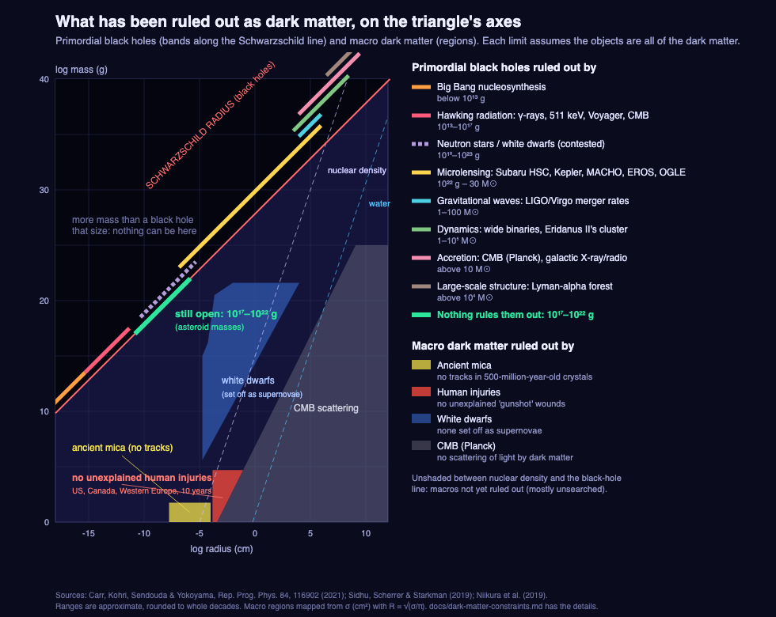

# What has been ruled out as dark matter

The figure (`img/dark-matter-constraints.svg`) puts the limits on the chart's own
axes: log radius (cm) across, log mass (g) up. Every limit below assumes the objects
in question are **all** of the dark matter; most allow them as a small fraction.

## Primordial black holes

They sit on the Schwarzschild line (R = 2GM/c²), so only their mass is free. From
the lightest up (Carr, Kohri, Sendouda & Yokoyama, *Rep. Prog. Phys.* 84, 116902,
2021, unless noted):

| Method | Masses ruled out | How |
|---|---|---|
| Big Bang nucleosynthesis | below ~10¹³ g | Black holes evaporating in the first minutes to hours would have disturbed the making of helium, deuterium and lithium; the measured amounts match the standard model. |
| Hawking radiation still arriving | ~10¹³–10¹⁷ g | Under ~5 × 10¹⁴ g they have evaporated already. Up to ~10¹⁷ g they would still glow: limits from the gamma-ray background, the 511 keV positron line from the galactic centre, Voyager 1 counting electrons outside the heliosphere, and energy dumped into the gas before the CMB was released. |
| Neutron stars and white dwarfs (contested) | ~10¹⁸–10²³ g | A black hole captured by a neutron star would eat it from inside; one crossing a white dwarf might set it off as a supernova. Old ones survive, but these arguments are disputed (Montero-Camacho et al., *JCAP* 08, 031, 2019). |
| Microlensing | ~10²² g to ~30 M☉ | A black hole passing in front of a star briefly brightens it. Subaru Hyper Suprime-Cam on Andromeda (Niikura et al., *Nature Astronomy* 3, 524, 2019), Kepler, MACHO, EROS, OGLE. Below ~10²² g the lensing washes out (the star's disk and the light's wavelength are larger than the lens). |
| Gravitational waves | ~1–100 M☉ | If they were all the dark matter, LIGO/Virgo would see far more mergers: at most about a percent. Pulsar-timing arrays add limits from the waves their formation would leave behind. |
| Dynamics | ~1–10⁵ M☉ | Many heavy black holes would heat and break fragile systems: wide binary stars in our galaxy, the lone star cluster in the dwarf galaxy Eridanus II. They survive. |
| Accretion | above ~10 M☉ | Gas falling into them before the CMB was released would have heated the universe and marked the CMB (Planck sees no such marks); X-ray and radio glow from our galactic centre today. |
| Large-scale structure | above ~10⁴ M☉ | Many very heavy black holes would make matter grainy; the Lyman-alpha forest (hydrogen absorption in quasar light) is too smooth. |

**Still open: about 10¹⁷–10²² g** (asteroid masses): Hawking radiation closes it from
below, microlensing from above, and the neutron-star and white-dwarf arguments in
between aren't settled. A black hole there is somewhere between a thousandth of an
atom and a small virus across. On the map: `PBH_WINDOW` in `src/data.js`, and the
primordial black hole article.

## Macro dark matter

Dense lumps much heavier than a particle (quark nuggets, dark nuclei…), any size
from nuclear density down to the black-hole line. Limits from Sidhu, Scherrer &
Starkman, "Death and serious injury by dark matter" (2019; figs. 1–2), plotted with
R = √(σ/π) from their cross-sections σ:

| Method | What's ruled out | How |
|---|---|---|
| Ancient mica | below ~55 g, with a cross-section above ~10⁻¹⁵ cm² | A macro crossing a mineral leaves a melted track; slabs of mica hundreds of millions of years old show none. |
| Human injuries | up to ~5 × 10⁴ g, cross-section above ~10⁻⁸–10⁻⁷ cm² | A macro hitting a person at ~250 km/s would leave a channel of destroyed tissue, much like a gunshot wound with no bullet. Medical records for the US, Canada and Western Europe over ten years show fewer than ten such unexplained deaths. It doesn't constrain primordial black holes: one in the asteroid window is far smaller than an atom and would pass through a body depositing almost nothing. |
| White dwarfs | ~10⁵–10²¹ g, a band near nuclear density | A macro crossing a white dwarf would heat a track and could set off a thermonuclear runaway (a supernova); old white dwarfs survive. |
| Cosmic microwave background | the fluffy side: cross-section per mass above ~4.5 × 10⁻⁷ cm²/g | Dark matter that scattered light that much would have left marks in the CMB; Planck sees none. |
| Microlensing | above ~4 × 10²⁴ g, any compact object | As for black holes. |

Between roughly nuclear density and the black-hole line, most masses are **not ruled
out** for macros, but few searches can reach them. The map used to show this as two
thin "possible areas for dark matter" windows along the black-hole line (from Jacobs,
Starkman & Lynn 2015); they were removed (PR #14) because the unexcluded region is a
wide wedge, not a strip, and macros are a niche candidate next to particles (WIMPs,
axions).

## Particles

WIMPs and axions sit on the far left of the chart near the Compton line (masses of
particles, sizes of their wavelengths). Decades of direct-detection experiments
(XENON, LUX, PandaX) have found no WIMP signal; axion searches continue. See the
"Search for Dark Matter" article (`content/descriptions/dark-matter-search.md`).

## Related notes

- Galaxies sit on their own low-density diagonal mostly because they are mostly empty
  space; dark matter lifts them about a decade. The evidence for dark matter is the
  mass measured from motion being ~10× what's visible
  (`video/sources/2026-10-19/NOTES.md`, "For the next recording session").
