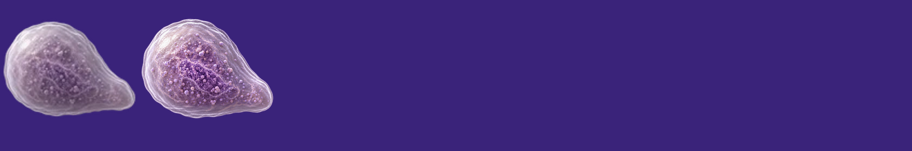
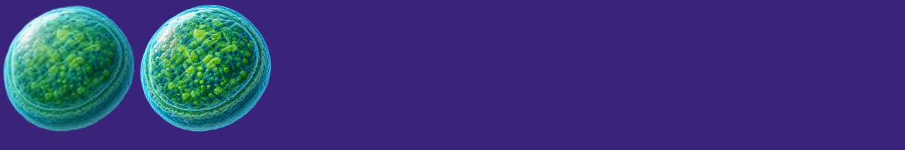
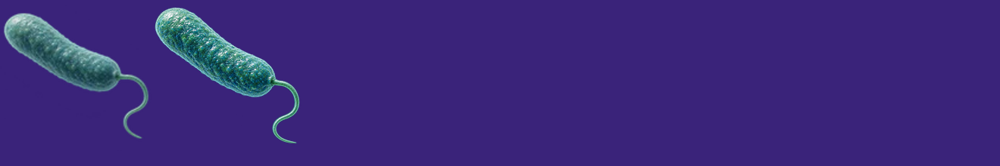
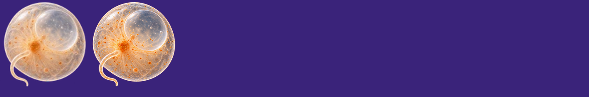
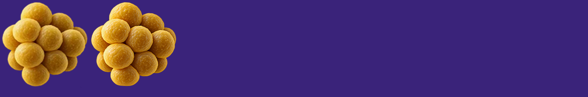
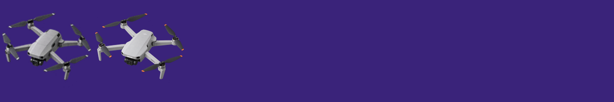

# Overnight icon review

Queued by the scheduled gen3 check while you were away. Each replacement shows the current icon on the left and the new master on the right; nothing here is installed yet.

Started 2026-10-21 22:40.

## Replacements to decide

The install step crops every master to the same 122/128 fill, so a "tighter framing" v2 only matters if the drawing itself is better.

- **Caulobacter vibrioides** (caulobacter-vibrioides):  new master `caulobacter-v2.png` — Image agent: same subject, fills more of the canvas (tighter framing).
- **Mycoplasma pneumoniae** (mycoplasma-pneumoniae):  new master `mycoplasma-v2.png` — Image agent: tighter framing alternative.
- **Prochlorococcus marinus** (prochlorococcus-marinus):  new master `prochlorococcus-v2.png` — Image agent: tighter framing alternative.
- **Pseudomonas aeruginosa** (pseudomonas-aeruginosa):  new master `pseudomonas-v2.png` — Image agent: tighter framing alternative.
- **Noctiluca scintillans** (noctiluca-scintillans):  new master `noctiluca-v2.png` — Image agent: tighter framing alternative.
- **Staphylococcus aureus** (staphylococcus-aureus):  new master `staphylococcus-aureus-v2.png` — Image agent: tighter framing alternative.
- **Meerkat** (meerkat):  new master `meerkat-v2.png` — Image agent recommends v2 for its higher camera, matching the other isometric animals.
- **DJI Mini 2** (dji-mini-2):  new master `dji-mini-2.png` — a second drone render; the current icon came from `dji-drone.png`.

## New objects (check the numbers)

- **Voyager Golden Record** (added, committed `fbb977b`): 30.5 cm across (NASA), so log R = 1.18 (half-width 15.25 cm). **Mass ~0.5 kg is an estimate**: no published figure; a ~1 mm copper disc that size is ~0.65 kg. Density 8.9 g/cm³ (copper). Next to the soccer ball, machine amber.
