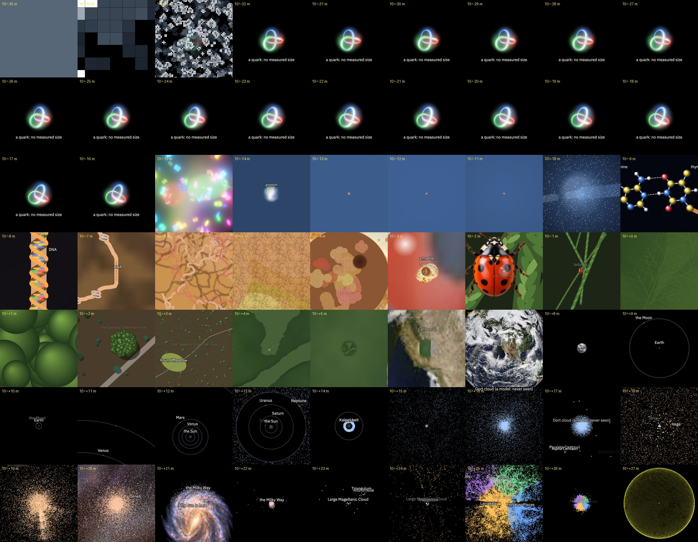

# Powers of ten: the zoom (rough)

The renderer for video 7 (plan: `video/plans/07-powers-of-ten.md`). One page,
`tools/powers-of-ten.html` (code in `tools/powers-of-ten/`), where everything is drawn from
one number: **s = log₁₀ of the frame's width in metres** (the stage's shorter side).

```bash
npm run dev
```

Then open http://localhost:5173/tools/powers-of-ten.html. To zoom, scroll, pinch, or press
←/→ (with shift for half a decade). Space plays the zoom outwards. The URL takes `?s=` for the
frame width, `?stage=9x16`, `?grid=0`, `?labels=0` and `?ui=0`.



## The centre never moves

The proton of one hydrogen atom stays at the centre the whole way. That hydrogen holds
thymine to adenine (the N3–H···N1 bond) in a DNA double helix. The DNA is wound into
chromatin in the nucleus of an amoeba. The amoeba sits in a drop of dew on a ladybug's
right wing case. The ladybug is on a sprig of the General Sherman tree in Sequoia National
Park, seen from straight above. Zooming out, the camera turns smoothly: from looking down
on the tree, to looking down on the ecliptic, then the Galaxy, then the supergalactic
plane, so the galaxies' flows lie flat.

| s (log₁₀ m) | What | How it's drawn |
| --- | --- | --- |
| −35 … −32 | Planck grid, a Game of Life with one cell per Planck length | code (`small.js`) |
| −21 … −15 | one quark, drawn at 10⁻¹⁹ m across (no measured size; that is the colliders’ limit), a point until it grows past the frame | Hopf renderer (`public/hopf/hopf-core.js`) |
| −16 … −12 | the proton: a fuzzy ball, then three quarks and the gluon sea as you zoom in | Hopf renderer, `proton-scale` |
| −14 … −9 | the hydrogen atom to scale, its 1s cloud (glow plus "where the electron is found" dots) | code |
| −10 … −8.5 | the A–T base pair (3DNA standard geometry), which turns edge-on | code |
| −9 … −6.5 | the double helix, side on | rough, for the image pass |
| −8 … −5 | chromatin: nucleosomes, then 10 nm fibres | rough |
| −6 … −3 | the nucleus: chromosome territories, nucleolus, envelope; cytoplasm | rough |
| −5 … −1 | the amoeba (`amoeba.webp`) in a dew drop on the ladybug (`ladybug.webp`) | rough + icons |
| −2 … 1.5 | sequoia shoots with scale leaves, the twig, foliage clumps | rough (procedural) |
| 0 … 4 | the crown from above, the grove, Round Meadow | rough (procedural) |
| 3 … 6 | the forest and the Sierra | rough (noise; weakest part) |
| 5 … 8 | California and the Earth | real: true-colour maps from `public/spectrum/earth-spectrum` |
| 8 … 16 | the Moon's orbit, the planets on 2026-10-29, the Kuiper belt, the heliosphere | code |
| 14 … 18 | the Oort cloud | code (a model; it has never been seen) |
| 16 … 22 | stars: Hipparcos (nearest) and Gaia | data (`tools/sky-points`) |
| 19.5 … 24.5 | the Milky Way | **placeholder** `milky-way.webp`, laid on the galactic plane; to generate |
| 21.5 … 25 | the Local Group, 28 galaxies at their real positions | code |
| 23 … 26.5 | 2MRS galaxies as a cosmic web: each linked to its nearest neighbours (positions untouched), coloured by the attractor they flow to (a rough Laniakea); the camera swings 40° and back so depth shows | code, toy model |
| 26 … 27.6 | the spectrum page's Cloud: visible light, then the Planck bands, then the CMB sphere | `public/spectrum` (`?bare=1`, `spectrumControl`) |

## The image pass (DNA → Earth)

The frames in `rough/` are 1024 px squares, one every half decade (×3.16), from
`s-09.0.jpg` (1 nm across) to `s+07.5.jpg` (the whole Earth). Each frame's middle third is
the frame before it. The aim is to re-render each one in a single unified style, keeping
the composition so the frames still nest:

> Re-render this image as [style]. Keep the composition exactly: every shape, its size and
> its place in the frame. The middle third must still show the same thing as the previous
> image I gave you, at that size. Square, [n] px, no text.

Save the results as `plates/s-03.5.png` etc. and list them in `plates/manifest.json`:

```json
{ "plates": [{ "s": -3.5, "file": "s-03.5.png" }] }
```

Then open the page with `?plates=1`. The plates nest, smallest on top, with soft round
edges, and they replace the drawn layers between DNA and the Sierra. The globe, and
everything below DNA and above the Earth, stay drawn by code.

To re-export the frames (at 2048 px they come out as PNG):

```bash
PLAYWRIGHT_PATH=$(npm root -g)/playwright/index.js node scripts/powers-of-ten-export.mjs --px 1024 --jpg
```

The options are `--from`, `--to`, `--step`, `--names` (adds the names, for reference) and
`--out`.

## Still rough / next

- **Terrain at 10³–10⁶ m** is flat noise. It should become real aerial and satellite images
  (Landsat, NAIP), with the image pass hiding the joins.
- **The Milky Way** is the chart's icon. Generate one (no real photo from outside exists)
  at 34 kpc across, centred on the Galactic Centre, with the Sun 8.2 kpc out.
- **Laniakea** is five softened point masses. Replace it with Cosmicflows-4 (the plan's
  "supercluster visualizer").
- **The CMB's colours**: the selector slides from Gaia G to Planck 143 GHz and spreads
  out (`driveCloud` in `main.js`). Tune it to the look you like in the spectrum page.
- **Timing**: none yet. `window.zoom.set(s)` is the hook for a narration scene.
